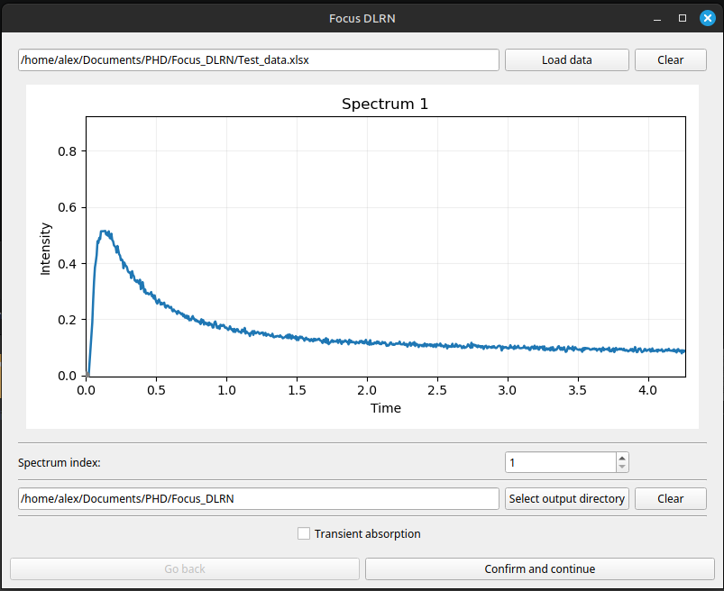
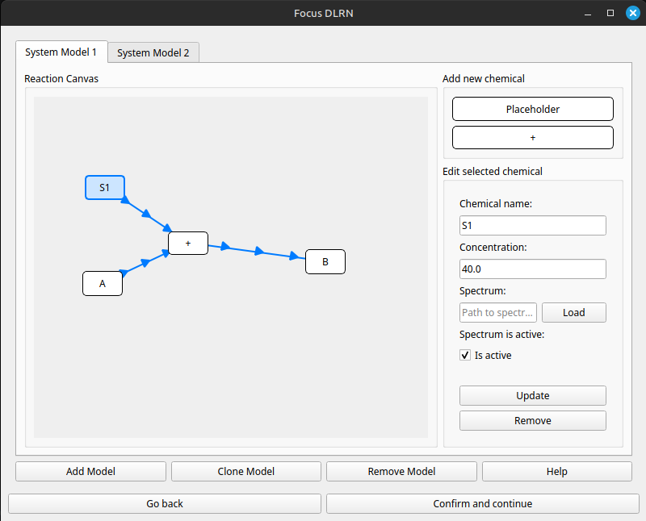
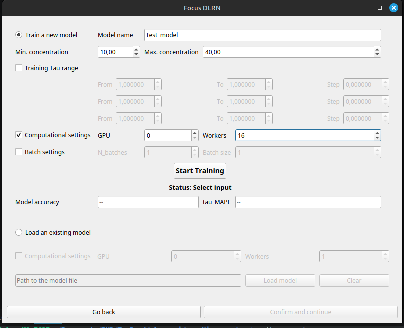
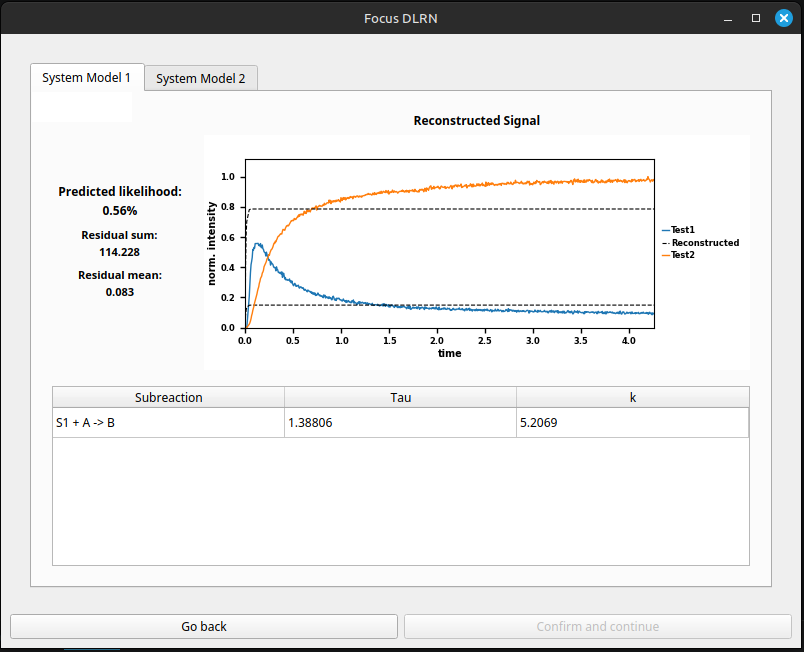

# Focus_DLRN_GUI

Focus DLRN provides a graphical user interface (GUI) to allow users to generate personalized neural network models specialized to resolve a selected number of chemical reaction networks (CRN), which can have first or second order pathways. The main goal of the GUI is to generate, in a dynamic and easy way, DLRN models dedicated to specific tasks.

The figure below shows the four pages that the user will go through to create a personalized DLRN model for analyzing measured data sets.

---

## Page 1 — Load Data

This is the data loading page for experimental data. By clicking the **"Load data"** button, users can select data for analysis, which is displayed in the central panel. The data can be screened by the spectrum index.

**Input format:** Excel file with the first column as time and the remaining columns as measured wavelengths.

Select an output directory where the DLRN model and data analysis will be saved. DLRN can be trained for **transient absorption** or **normal emission** data. To switch to transient absorption mode, tick the box *"Transient absorption"*.

---

## Page 2 — Chemical Reaction Network Builder

This page is used to define the chemical reaction network (CRN) that the model will learn during training. There is no strict upper limit on the number of models, but **no more than 10 models** are recommended to keep training times manageable (training time scales with the number of CRNs).

This is a **drag-and-drop panel** where placeholder species/chemicals can be dragged into the main canvas to create reaction nodes. The **"+"** button creates second-order reactions. For example, the figure shows the second-order reaction **S1 + A → B**, with reactant S1, initial active species A, and product B.

- **Active species** are chemicals that generate a signal in the measurement.
- **Maximum 5 active species** per CRN model.
- Concentration and name can be set for each chemical.

Buttons at the bottom allow you to **Add**, **Clone**, or **Remove** a CRN model. A **Help** button provides additional guidance. Click *"Confirm and continue"* to proceed to Page 3.

---

## Page 3 — Training Settings

This page configures the training parameters:

| Parameter | Description |
|---|---|
| **Model name** | Name for the DLRN model |
| **Min / Max concentration** | Training concentration range. Recommended: A\_exp\_min × 0.8 and A\_exp\_max × 1.2 |
| **Training Tau range** | Sets min/max tau values (up to 3 concatenated groups) for training pathways |
| **Computational settings** | Select the GPU (use `0` for a single GPU) and number of workers |
| **Batch settings** | Configure number of batches and batch size |

Click **"Start Training"** to begin. Upon completion, the GUI reports **model accuracy** and **tau\_MAPE** (mean absolute percentage error).

To use a pre-trained model, tick **"Load an existing model"** and select the model file. Click *"Confirm and continue"* to move to Page 4.

---

## Page 4 — Results

This is the results page where the neural network analyzes the experimental data loaded in Page 1. Results are displayed per CRN model and include:

- **Predicted likelihood** — probability confidence that the CRN is the correct one
- **Residual sum** and **Residual mean**
- **Reconstructed signal plot** — comparison between the fitted and experimental traces
- **Tau values** for each reaction pathway (shown in the table at the bottom)

Use the tabs (*System Model 1*, *System Model 2*, …) to browse results for each trained CRN. To trace back which CRN corresponds to each tab, navigate to Page 2.

---

## collaboration

This work is a collaboration partnership with the group of Prof. Dr. Susanne Gerber, Uni Medical Center, Mainz. https://csg.uni-mainz.de/group-member/susanne-gerber/